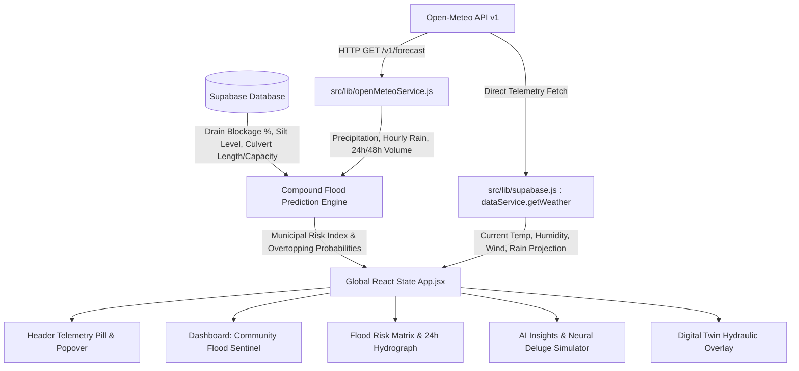

# GreenLens — Open-Meteo Weather & Hydrological Telemetry Integration

## 1. Executive Summary

In **GreenLens**, the **Open-Meteo API** (`https://open-meteo.com/`) serves as the core real-time meteorological engine. It provides hyper-localized weather forecasts, precipitation modeling, and convective storm data for municipal catchment areas (defaulting to **Winneba, Ghana**: Latitude `5.34352° N`, Longitude `-0.62566° W`).

Rather than displaying static weather forecasts, GreenLens synthesizes live Open-Meteo rainfall telemetry with physical infrastructure data from **Supabase** (culvert dimensions, drain blockages, silt accumulation, and citizen obstruction reports) to execute **dynamic compound flood risk prediction** and early overtopping warnings.

---

## 2. Architecture & Data Flow



---

## 3. Core Modules & Implementation Details

### A. Telemetry Fetcher (`src/lib/openMeteoService.js`)

The `fetchOpenMeteoForecast(coords)` function requests meteorological vectors from Open-Meteo:

```javascript
const url = `https://api.open-meteo.com/v1/forecast?latitude=${lat}&longitude=${lon}&current=temperature_2m,relative_humidity_2m,precipitation,rain,weather_code,wind_speed_10m&hourly=precipitation_probability,precipitation,rain&daily=precipitation_sum,precipitation_probability_max&timezone=auto`;
```

#### Monitored Variables:
| Parameter | Category | Purpose in GreenLens |
| :--- | :--- | :--- |
| `temperature_2m` | Current | Real-time ambient temperature indicator |
| `relative_humidity_2m` | Current | Atmospheric moisture and saturation factor |
| `precipitation` / `rain` | Current | Instantaneous rainfall rate (mm/h) |
| `weather_code` | Current | WMO weather interpretation (0 = Clear to 95 = Thunderstorm) |
| `wind_speed_10m` | Current | Wind telemetry affecting stormwater drift |
| `hourly.precipitation` | Forecast | 24h/48h hourly rainfall rates for hydrograph plotting |
| `hourly.precipitation_probability`| Forecast | Probability curves for predictive alert modeling |
| `daily.precipitation_sum` | Forecast | Daily accumulated rainfall projections |

---

### B. The Compound Flood Prediction Engine

The `calculateCompoundFloodPredictions(drainageSegments, meteoData)` function synthesizes meteorological rainfall with physical drainage constraints using civil engineering hydrological principles (Rational Method):

#### 1. Effective Culvert Discharge Capacity
$$\text{Effective Capacity } (m^3/s) = \text{Capacity}_{\text{nominal}} \times \left(1 - \frac{\text{Blockage } \%}{100}\right)$$

#### 2. Catchment Storm Runoff Inflow
Calculated using the **Rational Runoff Method**:
$$Q = \frac{C \cdot I \cdot A}{360}$$
- **$C$ (Runoff Coefficient):** `0.75` (typical for impervious urban and market surfaces).
- **$I$ (Rainfall Intensity):** Rolling 24-hour Open-Meteo precipitation rate in $mm/hr$.
- **$A$ (Effective Catchment Area):** Estimated drainage surface acreage derived from segment length.

#### 3. Surcharge & Overtopping Probability
$$\text{Surcharge Ratio} = \frac{\text{Estimated Storm Inflow } (m^3/s)}{\text{Effective Discharge Capacity } (m^3/s)}$$
$$\text{Overtopping Probability } (\%) = \min\left(99, \; \text{round}\left(\text{Surcharge Ratio} \times 65 + \text{Blockage} \times 0.35\right)\right)$$

#### 4. Time to Overflow Estimation
- If $\text{Surcharge Ratio} \ge 1.2$: Overtopping in $\approx \frac{6}{\text{Surcharge Ratio}}$ hours.
- If $0.8 \le \text{Surcharge Ratio} < 1.2$: Bank surcharge within 8 to 12 hours.
- If $\text{Surcharge Ratio} < 0.8$: Stable flow ($> 24$ hours).

#### 5. Municipal Compound Risk Score (0 - 100)
$$\text{Compound Risk Score} = \min\left(100, \; (\text{Blockage} \times 0.45) + (\text{Surcharge Ratio} \times 35) + \text{Rainfall Factor}\right)$$

---

## 4. UI Integrations Across the Dashboard

### 1. Global Header (`src/components/layout/Header.jsx`)
- **Telemetry Pill:** Displays current ambient temperature and 24-hour rainfall projection (e.g. `28°C • 🌧️ 28.5mm`).
- **Open-Meteo Popover:** Clicking the pill opens a detailed popover with projected 24h precipitation, precipitation probability, humidity, wind, and automated hydrological impact advisories.

### 2. Dashboard Overview (`src/components/views/DashboardView.jsx`)
- **Community Flood Sentinel Card:** Features the live status radar (`● LIVE RADAR`), dynamic risk assessment (`Risk Level: Low / High`), real-time rain forecast ticker, and quick precaution links.
- **Flood Radar Quick Tile:** Direct 1-click access to the flood risk analysis and surcharge forecast.

### 3. Flood Risk Matrix & Hydrograph (`src/components/views/FloodRiskView.jsx`)
- **24-Hour Precipitation Hydrograph:** Renders interactive visual hourly precipitation bars with safe runoff thresholds ($< 3\text{ mm/h}$) vs. culvert surcharge threat zones ($\ge 3\text{ mm/h}$).
- **Forecast Horizon Selectors:** Allows municipal operators to toggle between 6H, 12H, 24H, and 48H predictive windows.
- **OpenStreetMap Spatial Risk GIS:** Cross-references Open-Meteo rainfall with mapped culverts and flood inundation polygons.

### 4. AI Insights & Deluge Simulator (`src/components/views/AIInsightsView.jsx`)
- Uses baseline Open-Meteo storm figures to let officers simulate extreme deluge events ($10\text{ mm/hr}$ up to $120\text{ mm/hr}$) combined with variable debris choking ($+0\%$ to $+80\%$) to test proactive cleanup effectiveness before storms hit.

---

## 5. Resilience & Offline Fallbacks

If the external Open-Meteo API is unreachable or rate-limited:
1. `openMeteoService.js` and `supabase.js` intercept network errors gracefully.
2. A realistic hydrological fallback object based on historical West African coastal precipitation profiles is supplied.
3. The dashboard alerts operators with a `Hydrological Fallback` / `Cached Telemetry` tag, preventing UI degradation or crashes.
